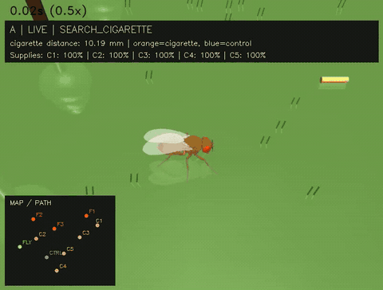

# CigaretteFly

Eksperyment wyłącznie komputerowy: cyfrowa mucha w **3D, FlyGym/MuJoCo**,
spiking connectome Shiu/FlyWire i plastyczność KC→MBON bramkowana PAM.
Abstrakcyjny obiekt `cigarette` emituje sztuczny zapach; kontakt zwiększa wirtualne
nicotine, które pobudza PAM. Porównujemy A (PAM) z B (bez wymuszonego PAM).

## Nagranie symulacji



Animowany podgląd odtwarza się bezpośrednio w README. [Nagranie MP4 w pełnej jakości (60 sekund)](docs/media/A_LIVE_0.mp4).

## Uruchomienie

[Instalacja, uruchomienie, test bez uczenia i ograniczenia](experiments/smoking/README.md).

```bash
.venv/bin/python experiments/smoking/smoking_experiment.py
```

CSV, wykresy, wagi i nagrania 3D: `results/smoking/`. Powstanie preferencji jest
hipotezą do sprawdzenia, nie zakodowanym wynikiem eksperymentu.
